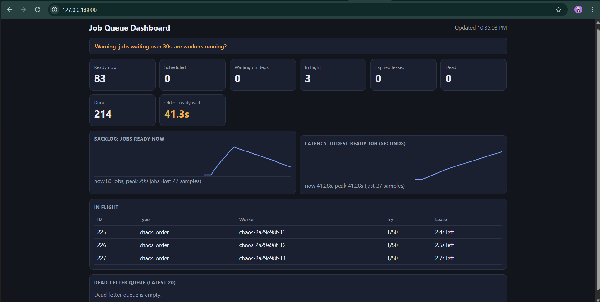

# Reliable Job Queue


A background-job engine built from scratch in **Python + MySQL**: the machinery frameworks
like Celery and Sidekiq hide. No queue library, just SQL, transactions and careful design.

Built to answer one question: **what does "reliable" actually mean when machines crash
mid-task?**

> Learning project. It is tested hard, but it is not a replacement for a production queue.
> See [Limitations](#limitations).

## Try it in 2 minutes

```bash
docker compose up -d                       # MySQL 8 in Docker
python -m venv .venv && source .venv/bin/activate     # Windows: .venv\Scripts\activate
pip install -e ".[dev,api]"
python -m jobqueue init-db
python -m jobqueue demo                    # guided tour, cleans up after itself
python -m jobqueue chaos                   # hard-kills real workers; every job still finishes
python -m jobqueue serve                   # live dashboard at http://127.0.0.1:8000/
```

## What it does

| # | Requirement | How |
|---|---|---|
| 1 | Durable queue | Jobs live in MySQL (InnoDB), not memory; they survive worker, process and database restarts |
| 2 | Priorities + scheduling | `priority DESC, run_at, id` ordering; `--delay` sets a future `run_at` |
| 3 | Retries with backoff | Exponential backoff + jitter, capped delay, capped attempts |
| 4 | Dead-letter queue | Exhausted jobs become `dead`; inspect, replay or purge them |
| 5 | Never two workers at once | `SELECT ... FOR UPDATE SKIP LOCKED` + **leases** + ownership (fencing) checks |
| 6 | Inspection | `stats`, `in-flight`, `dead list`, a read-only HTTP API and a live dashboard |
| 7 | Idempotency | `run_once(key, action)`: idempotency key + effect in one transaction |
| + | Job dependencies | B runs only after A succeeds; cycles are impossible by construction |
| + | Live dashboard | Polling, no libraries, XSS-safe rendering, CSP nonce |



Also: a **chaos test**, **retention** (`prune`), a guided **demo**, and **CI** on Python 3.10 and 3.12.

## Architecture

```
  producers                    MySQL 8 (InnoDB)                         consumers
  ---------                    ----------------                         ---------

  CLI enqueue  --+        +------------------------------+        +--> Worker 1 --+
  your code    --+------->|  jobs                         |<-------+--> Worker 2 --+--> handlers
                 enqueue  |   status, priority, run_at,   |  claim  +--> Worker N --+      |
                          |   attempts, locked_by,        | (SKIP LOCKED + lease)          |
                          |   lease_expires_at            |                                v
                          |  job_dependencies             |                      run_once(key, action)
                          |  side_effects (idempotency)   |<-----------------------  (same transaction)
                          +---------------^---------------+
                                          |
        read-only: stats / in-flight / dead / dashboard (FastAPI, 127.0.0.1)
```

### Job lifecycle

```
 enqueue --> WAITING --(all dependencies done)--> PENDING --(worker claims, lease starts)--> IN_FLIGHT
                                                    ^                                          |
                                                    |        +-------------+-------------+----+
                                                    |     success        failure     lease expired
                                                    |        |              |        (worker died)
                                                    |        v              v              |
                                                    |      DONE     attempts left? ------- +
                                                    |                 yes: back to PENDING,
                                                    +-----------------after backoff delay
                                                                      no:  DEAD --(replay)--> PENDING
```

## How reliability works

**Claiming.** A worker claims a job inside one transaction: `SELECT ... FOR UPDATE SKIP LOCKED`
locks the row (other workers skip it instead of waiting), then an `UPDATE` marks it
`in_flight` with a lease.

**Leases.** Every claim carries a lease. If the worker dies, the lease expires and another
worker reclaims the job. Only the current owner can complete or fail a job (**fencing**), so
a slow "zombie" worker cannot overwrite the new owner's result.

**Delivery guarantee.** At-least-once. A job is never lost, but can run twice (a slow worker
loses its lease, a worker dies before reporting success, a dead job is replayed). Exactly-once
delivery does not exist; **exactly-once effects** = at-least-once delivery + idempotent handlers.

**Idempotency.** `run_once(key, action)` inserts the key (PRIMARY KEY) in the same transaction
as the effect. A duplicate key means the effect already happened, so the action is skipped.
Keys come from *business identity* (`charge:order-123`), not job ids.

**Retries.** `delay = min(cap, base * 2^(attempt-1))`, randomised to 50-100% (jitter) to avoid
retry storms and thundering herds. Attempts are counted at **claim** time, so a job that keeps
crashing its worker is retired instead of looping forever.

**Time.** All timing (leases, delays, ages) uses the database clock `NOW(6)`, never worker clocks.

## Usage

```bash
# producing
python -m jobqueue enqueue send_email to=a@b.com subject=Hi
python -m jobqueue enqueue send_email to=boss@b.com --priority 10      # higher runs first
python -m jobqueue enqueue send_email to=a@b.com --delay 600           # in 10 minutes
python -m jobqueue enqueue send_email to=a@b.com --depends-on 1        # after job 1 succeeds

# consuming (run several in separate terminals)
python -m jobqueue worker
python -m jobqueue worker --drain --lease-seconds 30 --backoff-base 2 --backoff-cap 300

# inspecting
python -m jobqueue stats [--by-type] [--json]
python -m jobqueue in-flight
python -m jobqueue show 42

# dead-letter queue
python -m jobqueue dead list [--job-type email]
python -m jobqueue dead replay 42            # or: dead replay --all --job-type email
python -m jobqueue dead purge 42             # or: dead purge --all --yes
python -m jobqueue cancel 43                 # remove a waiting job nothing depends on

# maintenance
python -m jobqueue prune --days 7 [--dry-run]
```

Writing a handler:
```python
from jobqueue.registry import handler
from jobqueue.effects import run_once

@handler("charge_card")
def charge_card(job):
    p = job["payload"]
    run_once(f"charge:{p['order_id']}", lambda cur: insert_charge(cur, p), job["id"])
```

### What the stats mean
| Field | Meaning | Worry when |
|---|---|---|
| `pending_ready` | Waiting and due now (backlog) | keeps growing |
| `oldest_ready_age_seconds` | How long the longest-waiting ready job has waited | keeps growing |
| `in_flight_expired` | Lease ran out: worker died **or is just slow** | stays above 0 |
| `waiting_blocked` | Waiting on a dead dependency | above 0 |
| `dead` | Jobs that need a human | above 0 |

### HTTP API (read-only, `127.0.0.1`)
`GET /health`, `/stats`, `/stats/by-type`, `/jobs/in-flight`, `/jobs/dead`, `/jobs/{id}`, and the
dashboard at `/`. Interactive docs at `/docs`. It has no authentication, so it cannot replay or
purge and is bound to localhost.

## Proving it: the chaos test

```bash
python -m jobqueue chaos                      # idempotent handler: should PASS
python -m jobqueue chaos --naive --seed 7     # broken handler: should FAIL (on purpose)
```
Starts real worker **processes**, hard-kills them mid-job (`SIGKILL` / `TerminateProcess`: no
cleanup code runs) and asserts three **invariants**: every job completes, exactly one charge per
order, exactly one receipt per order. `--naive` removes idempotency to prove the test can fail.

## Testing

```bash
pytest -v        # 166 tests
```
Tests use a separate `jobqueue_test` database (they truncate tables) and the suite refuses to run
against any database not ending in `_test`. CI runs everything on Python 3.10 and 3.12 against a
real MySQL 8 service. First time on an existing MySQL volume? Create the test database once:
```bash
docker exec -it jobqueue-mysql mysql -uroot -prootpw -e "CREATE DATABASE IF NOT EXISTS jobqueue_test; GRANT ALL PRIVILEGES ON jobqueue_test.* TO 'jobqueue'@'%';"
```

## Project layout

```
src/jobqueue/
  config.py      settings from environment variables
  db.py          connections + transaction() helper (READ COMMITTED)
  schema.py      tables + idempotent index/ENUM migrations
  core.py        enqueue, claim, complete, fail, DLQ, dependencies, retention
  worker.py      worker loop           registry.py / handlers.py   job handlers
  backoff.py     exponential backoff   effects.py                  run_once (idempotency)
  stats.py       health snapshot       api.py + static/            read-only API + dashboard
  chaos.py       chaos test            demo.py                     guided demo
  cli.py         command line
tests/           166 tests (unit, concurrency, CLI, API, chaos)
docker/          test-database init script
.github/workflows/ci.yml
```

## Design decisions and trade-offs

- **MySQL over SQLite:** real row-level locks and `SKIP LOCKED`; the same mechanics work in Postgres.
- **A status, not a second table, for the dead-letter queue:** replay is one atomic `UPDATE`.
- **Strict priority:** simple, but low-priority jobs can starve (priority aging would fix it).
- **Cycles prevented, not detected:** dependencies are immutable and must already exist.
- **Read-only API:** no auth, so no write endpoints; mutations stay in the CLI.
- **Polling dashboard:** SSE/WebSockets would hold a thread per viewer with blocking endpoints.
- **Idempotency keys are never auto-pruned:** how long duplicates can arrive is a business decision.

## Limitations

- Polling workers (no push notification), so throughput is limited by MySQL round-trips.
- No heartbeat thread: a job longer than its lease can be run twice (handlers must be idempotent).
- Every error is retried; there is no "permanent error" type that skips retries.
- External services cannot join our transaction: pass the idempotency key to the provider too.
- `stats` scans the table; very large installs need retention or counters.
- The chaos test kills workers, not MySQL or the network.

## Ideas for next steps
Priority aging, a `PermanentError` for non-retryable failures, rate-limited replay, a heartbeat
thread, per-job-type backoff, enqueue-time deduplication, Prometheus metrics, API authentication.

## What I learned
Race conditions and row locks, leases and fencing, delivery guarantees, idempotency design,
exponential backoff and jitter, transactions/ACID and isolation levels, indexes and `EXPLAIN`,
chaos testing with invariants, XSS and Content-Security-Policy, CI with service containers, and a
professional Git workflow (branches, PRs, conventional commits, tags, releases).

## License
MIT. See [LICENSE](LICENSE).